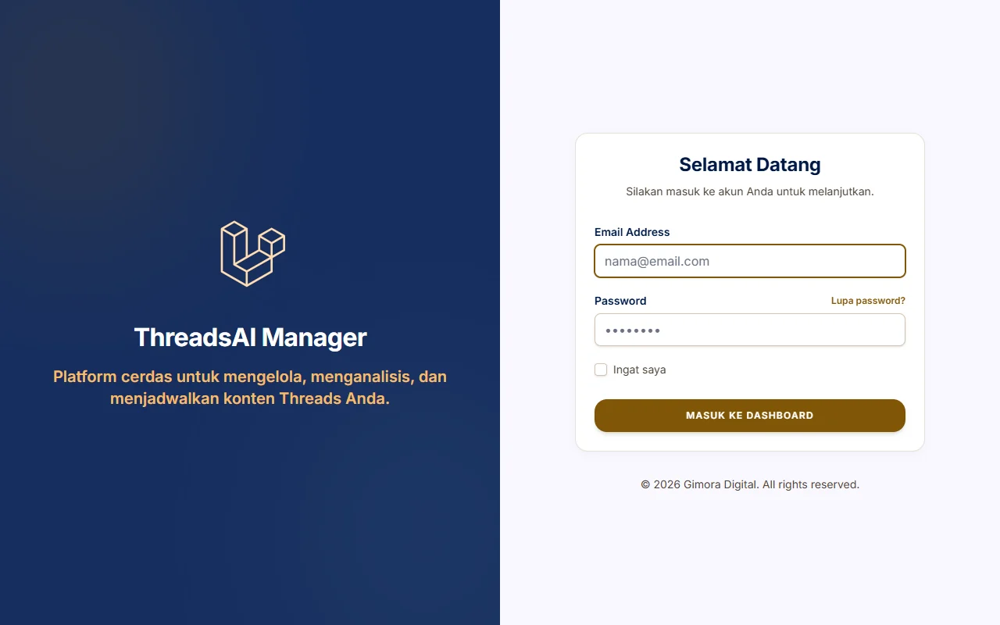

# Threadly (ThreadsAI Manager)

Platform manajemen konten **Threads** bertenaga AI untuk merencanakan ide, menyusun variasi hook & CTA, membuat visual poster di Image Studio, dan menjadwalkan publikasi.

🔗 **Live Portal:** [`https://threadly.gimmhost.my.id/`](https://threadly.gimmhost.my.id/)



### Stack & Kemampuan Inti

- **Full-Stack Laravel 13 + Vue 3 + Inertia.js v2** (`Tailwind CSS v4`, database queue driver untuk shared-hosting cPanel)
- **Copywriting & Hook Studio** — `POST /ai/content-assist` menghasilkan variasi hook, CTA, hashtag, dan catatan mutu dalam satu panggilan efisien via **TokenRouter** (`config/ai-models.php` & `config/ai-prompts.php`)
- **AI Poster Studio** — Menyempurnakan brief konten menjadi prompt visual terstruktur serta mendukung antrean pembuatan gambar terpusat

### Menjalankan Lokal

```bash
composer install && npm install && cp .env.example .env
php artisan key:generate && php artisan migrate --seed
npm run dev & php artisan serve
```

> Akun seed lokal default: `admin@gimoradigital.id` / `password` · Panduan deploy cPanel lihat [`HOSTING_CHANGES.md`](HOSTING_CHANGES.md).
